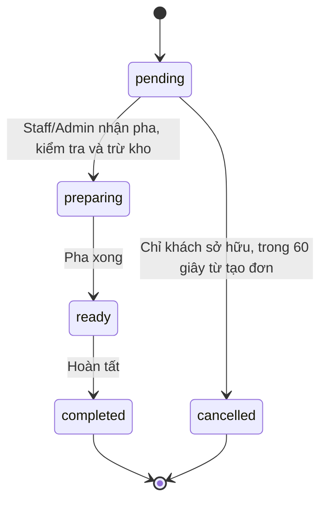
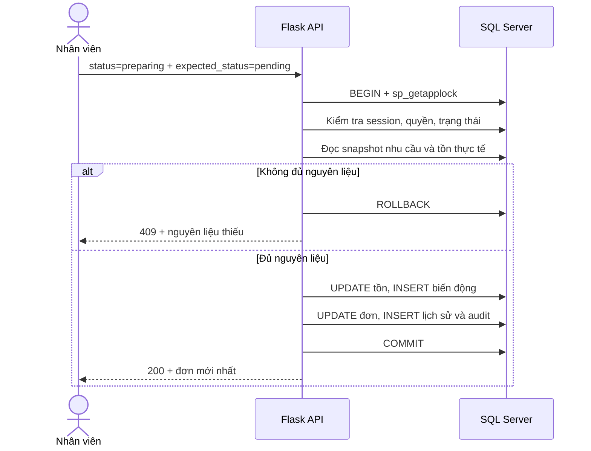

# Ánh xạ ERD và Data Dictionary

Đối chiếu các khái niệm trong `ERD C3.docx` với schema hiện hành ở `backend/maydrinks/models.py`.
Đây là ánh xạ **logic**, không khẳng định tên bảng/cột giống nguyên văn sơ đồ.
PDF đề bài mục 5 cho phép khác tên nếu đủ dữ liệu/rule/luồng nghiệp vụ.
Các thay đổi vật lý dưới đây phải được trình bày trong báo cáo thiết kế của nhóm.

## Ánh xạ thực thể / quan hệ

| Khái niệm đề / ERD | Bảng thực tế | Quan hệ và dữ liệu chính |
|---|---|---|
| Tài khoản / User / Role | `users` | PK `id`; username unique; password hash; `role` enum customer/staff/admin; active |
| Khách hàng / hồ sơ | `customer_profiles` | PK/FK `user_id` → users, quan hệ 1:1; name, phone unique, email unique có lọc NULL, address |
| Danh mục | `categories` | PK id; name unique; active |
| Đồ uống | `drinks` | FK category_id → categories; name, description, price VND, image, active, available |
| Tùy chọn / Size / Topping | `options` | kind=size/topping/sugar/ice; surcharge VND, factor, active |
| Đồ uống áp dụng tùy chọn | `drink_options` | PK ghép drink_id+option_id; quan hệ N:N có FK hai phía |
| Giỏ hàng | `carts` | FK user_id unique → users, mỗi tài khoản một giỏ |
| Chi tiết giỏ | `cart_items` | FK cart_id/drink_id; quantity 1–99; choices lưu ID size/sugar/ice/toppings |
| Đơn hàng | `orders` | FK user_id; thông tin giao snapshot; status; subtotal/discount/total; request_key; stock_deducted; created/completed |
| Chi tiết đơn | `order_items` | FK order_id/drink_id; tên/ảnh/giá/cấu hình/định lượng snapshot, số lượng |
| Lịch sử trạng thái đơn | `order_status_history` | FK order_id/actor_id; status, note, thời gian |
| Thanh toán (yêu cầu PDF) | `payments` | FK order_id unique; method=COD, amount, unpaid/paid, actor_id, paid_at |
| Công thức pha chế | `recipes` | FK drink_id/size_id; unique (drink_id,size_id); name, instructions, active |
| Chi tiết công thức | `recipe_lines` | FK recipe_id/ingredient_id; quantity>0, unit, scales_with none/sugar/ice |
| Nguyên liệu | `ingredients` | unit, quantity, minimum, last_price đều không âm; active |
| Định lượng topping | `topping_recipe_lines` | PK option_id+ingredient_id; quantity>0, unit; mở rộng để topping cũng trừ kho |
| Phiếu nhập kho | `inventory_receipts` | supplier, date, note, draft/confirmed, actor_id/confirmed_by, confirmed_at |
| Chi tiết phiếu nhập | `inventory_receipt_lines` | FK receipt_id/ingredient_id; quantity>0, price>=0 theo đơn vị tồn |
| Lịch sử biến động kho | `inventory_transactions` | FK ingredient_id, order_id/receipt_id tùy nghiệp vụ, actor_id; delta, balance>=0, unit_cost, reason, created_at |
| Phiên đăng nhập | `auth_sessions` | token SHA-256, FK user_id, expires_at; không lưu token thô |
| Khôi phục mật khẩu | `password_resets` | token hash, FK user_id, expires_at, used |
| Nhật ký | `audit_logs` | actor/action/entity/detail/time; không ghi mật khẩu/token |
| Ưu đãi (COULD) | `coupons` | PK code; percent 1–50, minimum>=0, expires_at, active |

## Khác biệt vật lý so với ERD khái niệm

- Role là cột có CHECK constraint trong `users`, không tạo bảng Role riêng vì chỉ có 3 giá trị cố định.
- Hồ sơ dùng chung cho cả 3 vai trò; staff/admin cũng có tên để ghi lịch sử người thao tác.
- 4 loại tùy chọn dùng một bảng có `kind`; `drink_options` biểu diễn tập tùy chọn hợp lệ của món.
- Công thức tách riêng cho mỗi **món + size**, không dùng hệ số size toàn cục để nhân hai lần.
- `cart_items.choices` là JSON ID, backend xác minh option đang hoạt động và thuộc món khi báo giá/lưu giỏ/đặt đơn.
- `order_items.choices` là **JSON snapshot** gồm ID, tên, loại, giá phụ thu, hệ số; không FK tới từng option sống. Đây là lựa chọn có chủ đích để ẩn/sửa option không đổi lịch sử.
- `order_items.requirements` lưu lượng nguyên liệu theo đơn vị tồn ở thời điểm đặt; bắt đầu pha dùng snapshot này, không dùng công thức vừa bị sửa.
- JSON không được dùng thay toàn bộ CSDL: tài khoản, món, giỏ, đơn, công thức, kho, phiếu nhập đều là bảng SQL Server với PK/FK.
- Xóa master data là **xóa mềm**. FK tới drink/ingredient không mất, lịch sử vẫn đọc được.
- Thêm payment, auth/reset, audit, topping lines, coupon để đáp ứng PDF và bảo mật; ERD nguồn cần bổ sung các bảng này trong báo cáo vật lý.

## Từ điển kiểu / đơn vị

| Nhóm | Quy ước |
|---|---|
| ID | String(36), UUID hoặc ID seed ổn định; receipt/order code unique |
| Nội dung tiếng Việt | SQL Server Unicode / NVARCHAR |
| Tiền bán | Integer, đơn vị VND, không dùng float để quyết định tổng tiền |
| Tồn / định lượng / giá nhập | Numeric(18,4); kiểm tra Decimal ở backend |
| Đơn vị | g↔kg (1000), ml↔l (1000), unit↔unit; cấm đổi khối lượng ↔ thể tích |
| Thời gian | UTC trong SQL, API ISO 8601 Z; giao diện hiển thị Asia/Ho_Chi_Minh |
| Mốc ngày báo cáo | Theo ngày UTC của backend; không giả định ngày local DB |
| Trạng thái bán | active=hiện/ẩn, available=còn phục vụ/tạm hết |
| Mật khẩu | Werkzeug scrypt ở runtime; test fixture dùng PBKDF2 nhẹ riêng, không dùng trên production |

## Ràng buộc và transaction

- UNIQUE username/phone/email; giỏ duy nhất/user; payment duy nhất/order.
- UNIQUE recipe món+size, kể cả recipe ẩn: khôi phục/sửa bản cũ, không tạo bản trùng.
- CHECK tồn>=0, định lượng>0, giá>=0, quantity 1–99, total=subtotal-discount.
- UNIQUE (user_id,request_key) chống tạo đơn trùng.
- Tất cả thay đổi nghiệp vụ khóa `sp_getapplock` trong transaction SQL Server.
- Xác nhận nhập kho tăng tồn + log + chốt phiếu cùng transaction, lặp lại không tăng hai lần.
- Nhận pha kiểm tra toàn bộ nhu cầu + trừ tồn + log + đổi trạng thái cùng transaction.
- Nguyên liệu đang thuộc công thức/topping active không được ẩn qua DELETE **hoặc** PATCH.

## State diagram

## Sequence nhận pha có kiểm tra kho

